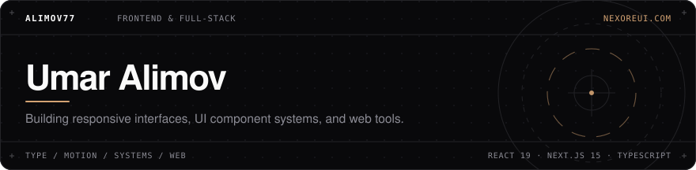
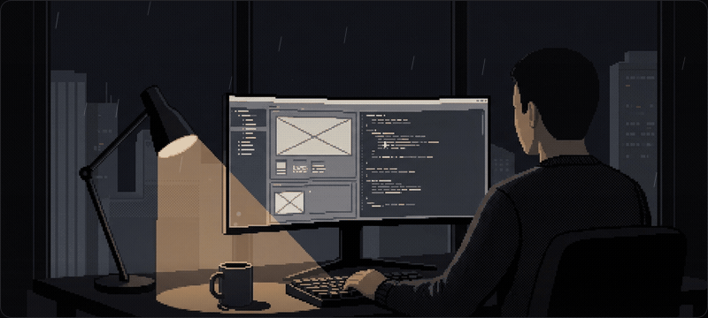

<picture>
  <source media="(prefers-color-scheme: dark)" srcset="./assets/hero-dark.svg" />
  <source media="(prefers-color-scheme: light)" srcset="./assets/hero-light.svg" />
  
</picture>

 

  <strong>Umar Alimov</strong> (<code>Alimov77</code>) — frontend and full-stack developer building responsive interfaces, UI component systems, and web applications with TypeScript, React, Next.js, and Tailwind CSS.

<picture>
  
</picture>

 

### Projects

| Project | Focus | Links |
| :--- | :--- | :--- |
| **[NexoreUI](https://nexoreui.com)** | Open-source React & Tailwind CSS v4 component library, CLI registry, and page templates | [Website](https://nexoreui.com) · [GitHub](https://github.com/Al1mov77/NexoreUI) · [npm](https://www.npmjs.com/package/nexoreui) |
| **[AI Job](https://github.com/Al1mov77/Ai-Job)** | Job description parser and resume match analyzer | [Repository](https://github.com/Al1mov77/Ai-Job) |

---

### Interface & Motion Experiments

<picture>
  
</picture>

---

### Tech Stack

<picture>
  <source media="(prefers-color-scheme: dark)" srcset="./assets/stack-dark.svg" />
  <source media="(prefers-color-scheme: light)" srcset="./assets/stack-light.svg" />
  
</picture>
