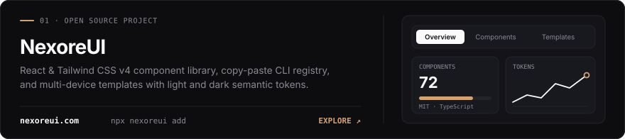
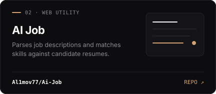
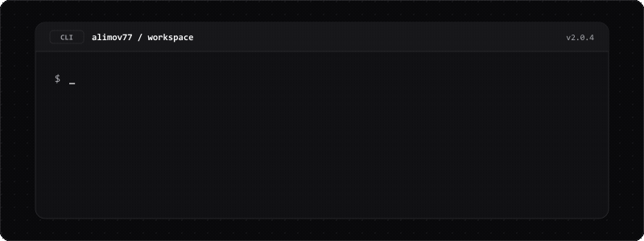

<picture>
  <source media="(prefers-color-scheme: dark)" srcset="./assets/hero-dark.svg" />
  <source media="(prefers-color-scheme: light)" srcset="./assets/hero-light.svg" />
  
</picture>

 

<picture>
  
</picture>

 

### Selected Work

<table>
  <tr>
    <td width="50%">
      <a href="https://nexoreui.com">
        <picture>
          <source media="(prefers-color-scheme: dark)" srcset="./assets/card-nexoreui-dark.svg" />
          <source media="(prefers-color-scheme: light)" srcset="./assets/card-nexoreui-light.svg" />
          
        </picture>
      </a>
    </td>
    <td width="50%">
      <a href="https://github.com/Al1mov77/Ai-Job">
        <picture>
          <source media="(prefers-color-scheme: dark)" srcset="./assets/card-aijob-dark.svg" />
          <source media="(prefers-color-scheme: light)" srcset="./assets/card-aijob-light.svg" />
          
        </picture>
      </a>
    </td>
  </tr>
</table>

  <a href="https://nexoreui.com">nexoreui.com</a> &nbsp;·&nbsp; <a href="https://github.com/Al1mov77/NexoreUI">GitHub Repository</a> &nbsp;·&nbsp; <a href="https://www.npmjs.com/package/nexoreui">npm Package</a>

 

### Interface & Motion

<picture>
  
</picture>

 

### Tech Stack

<picture>
  <source media="(prefers-color-scheme: dark)" srcset="./assets/stack-dark.svg" />
  <source media="(prefers-color-scheme: light)" srcset="./assets/stack-light.svg" />
  
</picture>
